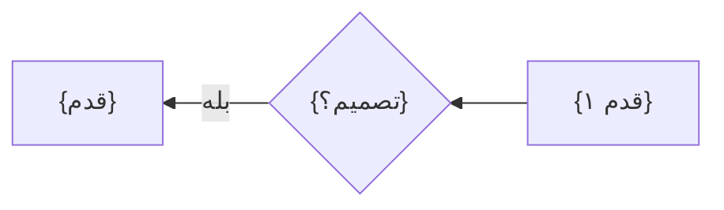

# فلوها و صفحه‌ها

## فلوها

### F1: {نام فلو}
- کاربر: {نقش} · کار: {شماره‌ی کار اصلی در idea.md}

1. {کاربر چه می‌کند} → S1
2. {…} → S2
   - اگر {شرط}: {چه می‌شود} → S{n}

## صفحه‌ها

### S1: {نام صفحه}
- هدف: {کاربر اینجا دقیقاً چه کاری را تمام می‌کند}
- در فلو: F1.1
- بلوک‌ها:
  1. {نام بلوک}: {چه نشان می‌دهد، به ترتیب از بالا، با نمونه‌ی واقعی کوتاه و بلند}
- اکشن‌ها:
  - {برچسب دکمه} → S2
- stateها:
  - empty: {اولین بار چه می‌بیند و قدم بعدی‌اش چیست}
  - loading: {…}
  - error: {مشکل چیست و راه جبران کدام است}
